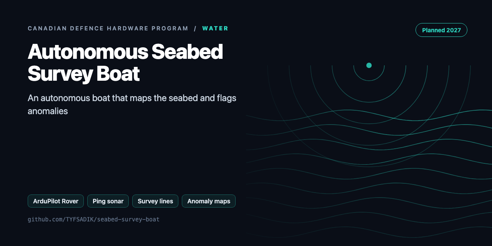
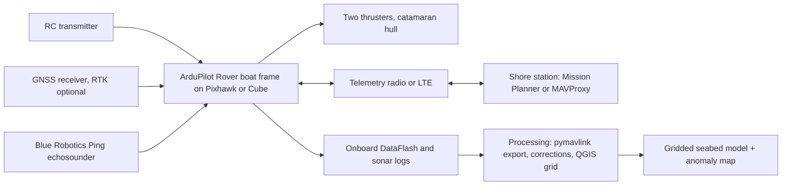

<div align="center">



# Autonomous Boat for Seabed Surveys and Anomaly Detection

**Build guide for an autonomous seabed-survey boat: ArduPilot lawnmower survey lines, Ping sonar depth logs, gridded anomaly maps scored on planted targets.**

[](https://github.com/TYFSADIK/seabed-survey-boat/actions/workflows/tests.yml)   [](LICENSE) [](https://github.com/TYFSADIK/defence-hardware-program)

[Build guide](docs/project-page.md) · [How it works](#how-it-works) · [Quick start](#quick-start) · [Program hub](https://github.com/TYFSADIK/defence-hardware-program)

</div>

## Overview

This project is a planned build of a small autonomous catamaran boat that surveys a lakebed on its own: it runs pre-programmed lawnmower survey lines under ArduPilot Rover, logs depth with a Blue Robotics Ping echosounder at each GPS fix, grids the results into a seabed model, and flags anomalies, which are scored against planted targets at known positions.

The reason to build it is concrete. On September 10, 2026, the Department of National Defence opened a solicitation for a Canadian autonomous mine-countermeasures (MCM) USV: an uncrewed surface vessel that surveys the seabed to detect, locate, and identify mines. Offers were due October 1, and only current supply-arrangement holders could bid. The broader initiative lists route surveying and port protection among its maritime priorities (verify). A solo builder cannot bid on that solicitation and cannot buy the swath sonars a real MCM vessel carries. What a solo builder can do is reproduce the survey-and-detect core of the problem at hobby scale: repeatable autonomous survey lines, georeferenced depth data, a gridded seabed model, and an anomaly detector scored against planted targets.

**Status: Planned.** This page is a published build guide against a real Canadian government spec. Nothing on this page has been built, launched, or tested yet. Every performance number here is either quoted from the sensor datasheet, calculated and marked (est.), or marked (verify) where a primary source was not confirmed. When the boat exists, the results pages will report only what was actually measured, in water that was actually sailed.

## How it works



## Quick start

```bash
python demo.py       # writes data/mission.waypoints
python -m unittest -v
```

Real output from the demo, run on simulated data:

```text
footprint at 3 m: 1.33 m -> line spacing 1.06 m, 57 lines
bathymetry grid (80, 60), depth 2.78-6.45 m; along-track sigma 0.029 m
objects: [(20.1, 30.2, 22, -0.54), (45.1, 59.9, 27, -0.54)]
score: {'detected': 2, 'planted': 2, 'pd': 1.0, 'false_alarms': 0, 'mean_pos_err_m': 0.2144310611540703}
```

## What's in this repo

| File | Purpose |
|---|---|
| `survey/plan.py` | Beam footprint → line spacing (planned for the shallowest water), lawnmower lines with run-ins, **QGC WPL 110** mission for ArduPilot Rover (boat) |
| `survey/process.py` | Draft, water-level, and **speed-of-sound** corrections (Marczak fresh water), confidence gating, **along-track target detection** (running-median residual with MAD sigma, before gridding so objects aren't averaged away), spatial clustering, gridding, IDW gap fill, grid-level median/MAD anomalies, scoring against planted targets |
| `survey/sim.py` | Simulated lake bed with planted targets and Ping-like single-beam behaviour (returns the shallowest point in the cone) |

## What you need

- Small catamaran hull with two thrusters (differential steering, stable sonar platform).
- Pixhawk or Cube flight controller running ArduPilot Rover (boat frame).
- GNSS receiver; RTK as an optional later upgrade for the vertical reference.
- Blue Robotics Ping echosounder, confirming which revision (current May 2023 revision vs original model) before ordering.
- Telemetry radio or LTE link for the shore station.
- Shore-station laptop with Mission Planner or MAVProxy.
- Power system sized from measured consumption, plus a way to log water temperature on every outing.

## Spec gaps

How the hobby build compares with the requirement it is built against:

| Requirement | Status | Notes |
|----|----|----|
| Autonomous survey lines | Planned | ArduPilot Rover lawnmower missions; repeatability to be measured over repeat runs |
| Detect objects on the seabed | Planned | Anomaly residuals in gridded Ping data, scored against planted targets; minimum detectable size to be published |
| Locate objects accurately | Planned | Position error measured against surveyed target positions; RTK optional, vertical error about 50 mm in one DIY report |
| Identify objects (mine vs rock) | Not tested | A single-beam echosounder returns depth, not imagery; identification needs swath sensors and is out of scope |
| Continuous seabed coverage | Partial, by construction | Only achievable when line spacing stays under the beam footprint; the spacing-versus-detection limit is a measured output, not a solved problem |
| Swath sensing (side-scan / multibeam) | Not tested | The real MCM sensor class; stretch goal is a scanning sonar, still far short of side-scan |
| Operational range and endurance | Not tested | Pond-scale surveys within sight; no open-water or long-endurance claim |
| Bid eligibility | Not applicable | Solicitation was restricted to current supply-arrangement holders; this page is a learning build, not a proposal |

## What gets measured

- Detection rate versus target size, depth, and line spacing, scored against the planted target field.
- False alarms per survey, with the repeat-survey change detection used to separate persistent anomalies from noise.
- Position error of reported anomalies against the surveyed ground-truth target positions.
- Minimum detectable target size at each surveyed line spacing and depth, stated as a measured limit.
- Survey time per hectare at the chosen spacings, so coverage cost is explicit.
- Battery use per hectare and per survey hour.
- Water temperature per outing, because April water sits near the sonar's lower operating limit.

## Related builds

- [Defence Hardware Program](https://github.com/TYFSADIK/defence-hardware-program), the umbrella page tying all six spec-driven builds together.
- [GPS-Denied Navigation Rover](https://github.com/TYFSADIK/gps-denied-navigation-rover), the ground-vehicle sibling that shares the same RTK-as-ground-truth and honest-gap-table discipline.
- [Thermal Search-and-Rescue Drone](https://github.com/TYFSADIK/thermal-sar-drone), the airborne sibling built against the MINERVA Arctic ISR requirement, with the same planted-target scoring approach.
- [Secure Fleet Updates](https://github.com/TYFSADIK/secure-fleet-updates), signed A/B updates and measured boot for exactly the kind of small autonomous fleet this boat would join.
- [Decision Black Box](https://github.com/TYFSADIK/decision-black-box), the tamper-evident logging pattern this build's survey and detection records will eventually adopt.

## Safety and legal

- Stay within sight of the boat at all times and stay off navigation channels.
- Get explicit permission for the water body before launching anything.
- Never launch alone from a slippery shore in cold water; spring water in southern Ontario is cold enough that a fall in is an emergency, not an inconvenience.
- No hobby-USV-specific rule was found in research, but the Vessel Operation Restriction Regulations limit power-driven vessels on some waters. Confirm the situation for the intended lake with Transport Canada boating safety (verify) before the first field day.
- Ice season ends the work: field trials are an April-May-after-ice-out activity, and the build calendar respects that.

## Learn more

The full build guide, with step-by-step instructions, wiring, troubleshooting and lessons learned, is in [docs/project-page.md](docs/project-page.md). It is also published at [tyfsadik.org](https://tyfsadik.org/work/defence/seabed-survey-boat.html).

## License

[MIT](LICENSE). Built by [Taki Sadik](https://tyfsadik.org) as part of the self-funded [Canadian Defence Hardware Program](https://github.com/TYFSADIK/defence-hardware-program).
